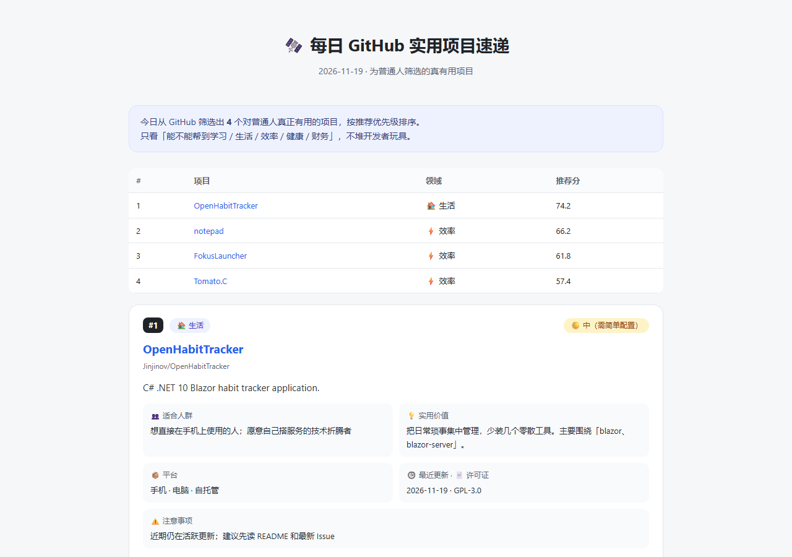

# GitHub Daily Monitor

> A zero-dependency Python tool that turns GitHub into a daily Chinese digest for non-technical people — with 30-day dedup, domain quotas, and optional AI summaries.



[中文说明](README.md) ｜ **English**

**See today's digest** → [daily-atk.github.io/github-daily-monitor](https://daily-atk.github.io/github-daily-monitor/) — updated daily, no install needed.

## Why this exists

GitHub Trending and curated newsletters are great for developers. But most "useful project" lists are still written for people who already know what a repository, a framework, or a CLI is.

This project takes the opposite view: **filter GitHub for things an ordinary person could actually use** — learning, daily life, productivity, health, and personal finance — and explicitly filter out developer infrastructure.

It is a tool, not a hand-curated magazine: run it yourself, schedule it, and publish the result for your family, friends, or community.

## Features

- **Zero runtime dependencies** — Python 3.10+ standard library only.
- **30-day recommendation cooldown** — the same project is not recommended again within 30 days.
- **7-day "seen" cooldown** — projects that appeared but were not selected get a short rest, configurable.
- **Domain quotas** — at most 3 items per domain by default, so one category cannot take over the report.
- **Daily keyword rotation** — all configured keywords are used over a few days, without extra API calls.
- **Readable Chinese report** — Markdown + a self-contained HTML page with platform, last-update date, and license.
- **One-click run** — `运行日报.bat` on Windows, `./run.sh` on macOS/Linux.
- **Optional AI enrichment** — any OpenAI-compatible endpoint, off by default, with `--dry-run` and a cost cap.
- **Optional GitHub Pages publishing** — a daily GitHub Actions workflow publishes the report and an archive index.
- **Tests and CI** — 36 unit tests, no network calls; GitHub Actions runs them on Python 3.10 and 3.13.

## Quick start

### Requirements

- Python 3.10 or newer
- No `pip install` needed

### Windows

1. Install Python from https://www.python.org/downloads/ and check **Add python.exe to PATH**.
2. Double-click **`运行日报.bat`**.
3. The latest HTML report opens automatically.

### macOS / Linux

```bash
chmod +x run.sh
./run.sh
```

Force a fresh collection even if today's candidates already exist:

```bash
./run.sh --force
```

### Manual commands

```bash
python monitor.py run            # collect + generate report
python monitor.py run --force    # force a fresh collection today
python monitor.py collect        # collect candidates only
python monitor.py report         # rebuild report from existing candidates
python monitor.py stats          # dedup history stats
python monitor.py validate       # check optional AI-enriched data
python enrich.py --dry-run       # preview the AI prompt and estimated cost
python enrich.py --enable        # call the configured LLM (optional)
python tools/build_index.py site # build the archive index page
python -m unittest discover -s tests -v
```

## How it works

```
collect candidates → mechanical filters → dedup → usefulness scoring
→ optional AI enrichment → Markdown + HTML report
```

- **Mechanical layer (Python)**: GitHub Search API, rate-limit handling, quality filters (missing description, excluded words, star/fork ratio, developer infrastructure), cooldown dedup, domain quotas, scoring.
- **Local phrase validation**: queries use a core term for recall, then each result must contain the meaningful words of the configured phrase. For example, `habit tracker` rejects `habitat`.
- **Optional AI layer**: an LLM can remove developer-only projects, rewrite the descriptions in plain Chinese, and reorder the list. Without it, the report uses rule-based fallback copy.

## Configuration

Edit `config.json` (keys starting with `_` are comments and are ignored):

| Key | Meaning |
|---|---|
| `keywords` | Search terms grouped by domain: learning, life, productivity, health, finance |
| `search.min_stars` | Minimum stars (default 50) |
| `search.max_queries_per_run` | Maximum search queries per run |
| `scoring.top_n` | Maximum items per report |
| `scoring.min_score` | Minimum score to enter the report |
| `scoring.max_per_domain` | Maximum items per domain (default 3; 0 = unlimited) |
| `dedup.cooldown_days` | Cooldown after a project is recommended (default 30) |
| `dedup.seen_cooldown_days` | Cooldown for seen-but-not-selected projects (default 7; 0 = off) |
| `output.formats` | `md` and/or `html` |

If the JSON is invalid, the program prints the line and column in Chinese with a hint about commas and quotes.

## GitHub token (recommended)

Anonymous GitHub Search API access is limited to about 10 requests per minute. A token raises the limit substantially.

1. Create a token at https://github.com/settings/tokens (classic token, no scopes needed).
2. Set it as an environment variable.

Windows:

```bat
setx GITHUB_TOKEN "ghp_your_token"
```

macOS / Linux:

```bash
export GITHUB_TOKEN="ghp_your_token"
# add to ~/.bashrc or ~/.zshrc to persist
```

Reopen the terminal after `setx` on Windows. The program reads the variable name configured in `github_token_env`.

## Optional AI enrichment

AI is **off by default**. Without it, `python monitor.py run` still produces a complete report using rule-based copy.

```bash
export LLM_API_KEY="..."
export LLM_MODEL="deepseek-chat"
export LLM_BASE_URL="https://api.deepseek.com/v1"   # any OpenAI-compatible endpoint
python enrich.py --dry-run
python enrich.py --enable --max-cost 0.05
```

Cost control:

- `--max-cost` is in USD and requires `LLM_PRICE_INPUT_PER_1M` / `LLM_PRICE_OUTPUT_PER_1M`.
- Token counts are estimated at roughly 4 characters per token; this is a guardrail, not a billing statement.
- The adapter only writes `data/enriched_latest.json`; it never installs or executes recommended projects.

## Publish to GitHub Pages

The repository includes `.github/workflows/daily.yml`:

1. Run the **Daily Digest** workflow once from the Actions tab.
2. Go to **Settings → Pages → Build and deployment → Source** and choose **Deploy from a branch**.
3. Select the **`gh-pages`** branch and `/ (root)`, then save.
4. Visit `https://daily-atk.github.io/github-daily-monitor/`.

The workflow runs daily at **12:00 UTC (20:00 Asia/Shanghai)**, generates the report, merges it into the existing site, rebuilds the archive index, and publishes to `gh-pages`. GitHub Actions cron may run a few minutes late.

## Project structure

| Path | Purpose |
|---|---|
| `monitor.py` | Main entry point: collect / report / run / stats / validate |
| `enrich.py` | Optional OpenAI-compatible enrichment |
| `lib/` | Collection, filtering, scoring, report rendering |
| `tools/build_index.py` | Archive index generator |
| `tests/` | Unit tests (stdlib `unittest`, no network) |
| `.github/workflows/` | CI and daily Pages publishing |
| `data/` | Runtime data (ignored by Git; only the example file is tracked) |
| `reports/` | Generated Markdown/HTML reports (ignored by Git) |
| `docs/launch/` | Draft launch posts |

## FAQ

**Does it need AI?** No. AI is optional and off by default.

**Does it need a GitHub token?** No, but anonymous rate limits are low and some queries may be skipped.

**Why are there no recommendations today?** All candidates may be in a cooldown window. Lower `dedup.cooldown_days` or `dedup.seen_cooldown_days`, or add more `keywords`.

**Does it upload my data?** No. It calls the public GitHub API and stores reports/history locally.

**Can I run it outside Windows?** Yes. Use `./run.sh` on macOS/Linux.

**Are the recommended projects safe?** This project only aggregates public information. It never installs or runs anything. Review each project, its license, and its issues before use.

## Content license

- **Code**: MIT, see [LICENSE](LICENSE).
- **Generated reports** (`reports/*.md` / `*.html`): suggested CC BY 4.0.
- Project names, descriptions, stars, and licenses come from the public GitHub API; copyright remains with their respective authors.
- **Not affiliated with GitHub.** No GitHub logo is used.

## Contributing and security

See [CONTRIBUTING.md](CONTRIBUTING.md) and [SECURITY.md](SECURITY.md). Never paste tokens into public issues.

## Roadmap

- [x] GitHub Actions daily run + Pages demo
- [x] Optional OpenAI-compatible LLM adapter
- [x] Archive index page
- [x] English summary and README
- [x] Report screenshot
- [ ] Full bilingual documentation for every config option
- [ ] Optional multi-source digest (Hacker News, Product Hunt)

## License

MIT — see [LICENSE](LICENSE).