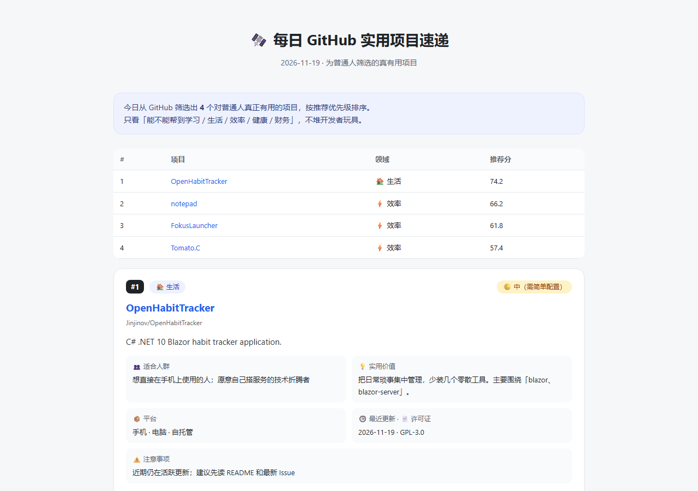

# 每日 GitHub 监测助手

[English](README.en.md) ｜ **中文**

> **给普通人的每日 GitHub 实用项目日报** —— 别人推荐"开发者觉得酷"的项目，这里只挑"普通人真能用上"的工具，每天 20:00 自动更新。

每天自动从 GitHub 捞出「对普通人真正有用」的新项目 / 有重要更新的项目，筛选后生成一份简洁总结（Markdown + HTML），按推荐优先级排序。**同一项目 30 天内不重复推荐。**

同一套代码提供**两个版本**，共用一份程序、配置与数据完全隔离：

| 版本 | 面向谁 | 排序依据 | 站点入口 |
|---|---|---|---|
| 📚 **普通人版**（默认） | 不写代码的人 | 对学习/生活/效率/健康/财务的实用价值 | 站点首页 |
| 🔥 **程序员热度榜** | 开发者、技术选型 | GitHub Trending 真实**新增 star** | 站点 `dev/` 页 |

**在线看两个榜单** → [daily-atk.github.io/github-daily-monitor](https://daily-atk.github.io/github-daily-monitor/)（打开网页即可，无需安装任何东西；页面顶部可切换两版）

## 快速开始

### 只想每天看看日报（零门槛）

直接打开 **[在线日报](https://daily-atk.github.io/github-daily-monitor/)**，无需安装、无需命令行。想自己掌控数据或改监测关键词，再看下面的本地运行方式。

### Windows：双击运行

双击 **`运行日报.bat`** —— 自动采集 + 生成报告，完成后打开最新 HTML；只想看已生成的报告就双击 **`打开今日报告.bat`**。首次使用先按 [`新手使用说明.md`](新手使用说明.md) 安装 Python（勾选 **Add python.exe to PATH**）。

### macOS / Linux

```bash
chmod +x run.sh
./run.sh              # 生成日报并打开
./run.sh --force      # 忽略当天已有候选，强制重新采集
```

更详细的零基础说明见 [`新手使用说明.md`](新手使用说明.md)。

## 演示



在线 Demo：**[daily-atk.github.io/github-daily-monitor](https://daily-atk.github.io/github-daily-monitor/)** —— 每天 20:00 自动更新，可直接分享给朋友。（在自己仓库启用 Pages 的方法见下文。）

## 两个版本

一份代码，两种受众。切换只需加 `--profile dev`，两版的配置、候选、去重库、报告目录各自独立，互不干扰。

**程序员热度榜**（`--profile dev`）的特点：

- 数据源是 **GitHub Trending 日榜**（可在 `config-dev.json` 改周榜），抓的是真实的「今日新增 star」，这是普通搜索 API 拿不到的热度信号。
- 排序按热度优先，开发者向信号（框架、库、SDK、LLM、数据库等）在这里是**加分项**，与普通人版正好相反。
- 补充 API 拿到的 topics / 许可证 / 最近更新（有缓存、自动降级），帮开发者快速判断技术栈和维护状态。
- 深色主题、榜单式排版，突出增长数字。

```bash
# 程序员热度榜：采集 + 生成（普通人版命令不变）
python monitor.py --profile dev run

# 只看/重生成程序员榜报告
python monitor.py --profile dev report

# 生成带双入口导航的归档首页（本地预览两个榜单）
python tools/build_index.py site --all
```

- 配置：`config-dev.json`（领域关键词、Trending 周期/条数、冷却期等都能改）。
- 输出：`reports-dev/`、`data-dev/`，与普通人版的 `reports/`、`data/` 完全分开。
- 想给程序员榜也加 AI 文案？它读的是 `data-dev/enriched_latest.json`，字段同普通人版（见 `AI_WORKFLOW.md`）；不加就用技术视角的兜底文案。

> 线上演示站每天 20:00 同时更新两个榜单：普通人版在首页，程序员榜在 `dev/` 页，顶部导航可切换。

## 它怎么工作

```
采集 GitHub 候选 → 机械过滤低质量 → 历史去重 → 普通人价值打分 → AI 语义终筛+文案润色 → 生成报告
```

- **机械层（Python 脚本）**：搜索、限流重试、过滤（无描述/排除词/星标/fork比/开发者基础设施）、冷却期去重、领域配额、打分排序。稳定可靠，无人值守也能跑。
- **语义层（AI，可选）**：脚本初筛出的候选交给 AI，判断"是否真对普通人有用"，剔除凑数项目，用中文写清功能/适合人群/实用价值/上手难度/注意事项，并重新排序。

### AI 是可选的

- **不配置任何 AI**：`python monitor.py run` 会直接生成报告，文案使用规则兜底模板（能用，但较笼统）。
- **想要更具体的文案**：按 [`AI_WORKFLOW.md`](AI_WORKFLOW.md) 让 AI 读取候选并生成 `data/enriched_latest.json`，再运行 `python monitor.py report`。
- **格式示例**：[`data/enriched_latest.example.json`](data/enriched_latest.example.json)。

也可以使用内置的 `enrich.py`（任意 OpenAI 兼容接口）：

```bash
export LLM_API_KEY="..."
export LLM_MODEL="deepseek-chat"
export LLM_BASE_URL="https://api.deepseek.com/v1"   # 任意 OpenAI 兼容地址
python enrich.py --dry-run
python enrich.py --enable --max-cost 0.05
```

费用上限需同时设置 `LLM_PRICE_INPUT_PER_1M` / `LLM_PRICE_OUTPUT_PER_1M`；不加 `--enable` 时绝不会调用接口。

## 文件结构

| 文件                                  | 作用                                                  |
| ----------------------------------- | --------------------------------------------------- |
| `config.json`                       | 普通人版配置：关键词、排除词、时间、阈值、Top N、输出格式                   |
| `config-dev.json`                   | 程序员榜配置：Trending 周期/条数、技术关键词、独立输出路径                  |
| `monitor.py`                        | 主程序（collect / report / run / stats / validate 五个命令） |
| `enrich.py`                         | 可选的 AI 文案增强（OpenAI 兼容，默认关闭）                         |
| `lib/`                              | 采集、过滤、打分、报告生成模块（`trending.py` 为程序员榜数据源）            |
| `tools/build_index.py`              | 生成历史归档索引页                                           |
| `AI_WORKFLOW.md`                    | 每日自动化 AI 的执行说明（作业指导书）                               |
| `README.en.md`                      | 英文说明                                                |
| `新手使用说明.md`                         | 面向零基础用户的步骤说明                                        |
| `docs/launch/`                      | V2EX / 少数派 / Reddit 发布文案                            |
| `运行日报.bat`                          | Windows 双击运行一次完整流程                                  |
| `run.sh`                            | macOS / Linux 一键运行                                  |
| `打开今日报告.bat`                        | 双击打开最新报告                                            |
| `data/history.json`                 | 历史去重记录（自动生成，勿手改）                                    |
| `data/run.log`                      | 运行日志（排查失败用，超过 1MB 自动轮转）                             |
| `data/candidates_latest.json`       | 最新候选数据                                              |
| `data/enriched_latest.json`         | AI 增强数据（可选，由 AI 生成）                                 |
| `data/enriched_latest.example.json` | AI 增强数据格式示例                                         |
| `data-dev/`、`reports-dev/`         | 程序员榜的独立数据与输出目录                                       |
| `tests/`                            | 单元测试（标准库 unittest，不发真实 API 请求）                      |
| `.github/workflows/ci.yml`          | GitHub Actions：语法检查 + 单元测试                          |
| `.github/workflows/daily.yml`       | GitHub Actions：每日定时运行并发布到 GitHub Pages              |
| `reports/`                          | 每日报告输出                                              |

## 常用命令

```bash
cd github-daily-monitor

python monitor.py collect    # 只采集候选（写 candidates_latest.json）
python monitor.py report     # 只生成报告（读取候选+当日增强数据）
python monitor.py run        # 采集+报告一步到位
python monitor.py run --force  # 今天已有候选也强制重新采集
python monitor.py stats      # 查看历史去重库统计
python monitor.py validate   # 校验 AI 增强数据是否与当日候选一致
python enrich.py --dry-run   # 查看 AI 增强 prompt 与预估费用（不发请求）
python enrich.py --enable    # 调用 LLM 生成增强数据（可选）
python tools/build_index.py site   # 生成普通人版归档索引页
python tools/build_index.py site --all   # 生成两版归档页（带切换导航）

# —— 程序员热度榜（所有命令加 --profile dev）——
python monitor.py --profile dev run       # 程序员榜：Trending 采集+报告
python monitor.py --profile dev report    # 只重生成程序员榜报告
python monitor.py --profile dev stats     # 程序员榜去重库统计
python -m unittest discover -s tests -v   # 运行单元测试
```

> 同一天重复运行时，默认会复用当天已有的非空候选，避免把已经生成的报告覆盖成空榜单；确实要刷新时加 `--force`。

## 如何配置

直接编辑 `config.json`（以 `_` 开头的键是说明，可忽略）：

- **监测关键词** `keywords`：按「学习/生活/效率/健康/财务」分组。程序每天轮换使用每组里的词，几天内覆盖全部，不用手动改。
- **每次查询数** `search.max_queries_per_run`：每个领域两条查询（近期新建 + 近期更新），默认 12 足够。
- **每个领域上限** `scoring.max_per_domain`：防止报告被单一领域刷屏，默认 3，0 = 不限。
- **排除词** `exclude_words.name` / `.description`：项目名或描述命中就过滤掉。
- **每日总结时间** `schedule.summary_time`：仅用于显示；真正触发时间由定时自动化控制（当前 20:00）。
- **每天推荐数量** `scoring.top_n`、最低分 `scoring.min_score`。
- **去重冷却期** `dedup.cooldown_days`（推荐过的项目，默认 30 天）；`dedup.seen_cooldown_days`（只是见过但没入选的项目，默认 7 天，0 = 不限制）。
- **输出格式** `output.formats`（md / html）。

配置文件写错时，程序会用中文指出第几行第几列有问题，并说明常见原因（逗号、中文引号等）。

### 可选：访问统计（默认关闭）

想知道有多少人真的打开日报，可在 `config.json` 的 `analytics` 段开启一个**隐私友好**的统计（不用 cookie、不采集个人信息，只统计访问量）。默认 `off`，不注入任何外部脚本：

```json
"analytics": { "provider": "plausible", "domain": "你的统计域名" }
```

- `plausible`：填 `domain`（如 `daily-atk.github.io`），用 Plausible 官方托管或自托管。
- `umami`：填 `website_id`，可选 `script_url`（默认 Umami 云）。
- `custom`：填 `script`（完整 `<script>...</script>` 标签，如 GoatCounter），只接受 https 外链。

统计脚本会同时注入每日报告页和历史归档页；关闭时两处都是纯静态、零外部请求。具体搭建步骤见 [`docs/FEEDBACK_LOG.md`](docs/FEEDBACK_LOG.md)。

## 提升采集额度（推荐）

匿名访问 GitHub Search API 限流很低（约 10 次/分钟，容易 403）。配置 Token 后可大幅提速：

1. 到 <https://github.com/settings/tokens> 生成一个 Token（classic 版无需勾选任何权限；fine-grained 版不授权任何仓库即可）。
2. 设置环境变量（把引号里换成你的 token）：

Windows（命令提示符）：

```bat
setx GITHUB_TOKEN "ghp_你的token"
```

macOS / Linux（终端）：

```bash
export GITHUB_TOKEN="ghp_你的token"
# 想永久生效，把这行写入 ~/.bashrc 或 ~/.zshrc
```

1. **Windows 需要关掉命令窗口再重新打开**（环境变量只对新窗口生效），运行 `echo %GITHUB_TOKEN%` 能看到内容即成功；macOS/Linux 用 `echo $GITHUB_TOKEN`。

脚本会自动读取 `config.json` 里 `github_token_env` 指定的变量名。不配置也能用，只是采集时部分查询可能因限流被跳过。

## 自动化（可选）

本项目不内置调度器。可选：

- **Windows**：用「任务计划程序」定时运行 `运行日报.bat`；
- **macOS / Linux**：用 `cron` 定时运行 `./run.sh`；
- **GitHub Actions**：直接使用仓库自带的 `.github/workflows/daily.yml`（见下一节）；
- 或使用支持定时任务的 AI 助手 / 自动化工具，按 `AI_WORKFLOW.md` 执行。

每次运行都会在 `data/run.log` 追加记录（开始/结束、查询数、过滤统计、异常堆栈）。日志超过 1MB 会自动轮转为 `run.log.1`。定时任务失败时先看这里。

## 发布到 GitHub Pages（可选）

仓库自带 `.github/workflows/daily.yml`：每天 UTC 12:00（北京时间 20:00）运行，生成当天日报并发布到 `gh-pages` 分支，同时更新历史归档索引页。

首次使用：

1. 在 Actions 里手动运行一次 **Daily Digest**；
2. 仓库 **Settings → Pages → Build and deployment → Source** 选 **Deploy from a branch**，分支选 **gh-pages** / root，保存；
3. 访问 [https://daily-atk.github.io/github-daily-monitor/](https://daily-atk.github.io/github-daily-monitor/)。

可以本地预览归档页：

```bash
python tools/build_index.py site
```

> GitHub Actions 的 cron 使用 UTC；`0 12 * * *` = 北京时间 20:00。定时任务可能延迟几分钟。

## 说明与免责

- 星标数、维护状态会实时变化，报告内容仅供参考，使用前请以项目页面为准。
- 数据来自 GitHub 公开 API，遵守其服务条款；报告为本地生成，不涉及隐私数据上传。
- 本项目只做信息聚合，不自动安装任何被推荐的项目或软件。

## FAQ

**没有 AI 能跑吗？** 能。`python monitor.py run` 会使用规则兜底文案，只是不如 AI 写得具体。

**需要 GitHub Token 吗？** 不强制；不配置时匿名额度较低，部分查询可能被跳过。

**为什么今天没有推荐？** 可能候选都在冷却期内。可调短 `dedup.cooldown_days` / `dedup.seen_cooldown_days`，或增加 `keywords`。

**会上传我的数据吗？** 不会。只访问 GitHub 公开 API，报告和历史都保存在本地。

**Windows 之外能用吗？** 能。macOS / Linux 执行 `./run.sh`。

**报告里的项目安全吗？** 本项目只做信息聚合，不自动安装任何软件；使用前请自行查看项目主页、许可证与 Issue。

## 内容许可

- **代码**：MIT，见 [LICENSE](LICENSE)。
- **自动生成的报告内容**（`reports/` 下的 md / html）：建议以 [CC BY 4.0](https://creativecommons.org/licenses/by/4.0/) 共享。
- 报告中引用的项目名称、描述、星标等信息来自 GitHub 公开 API，版权归对应作者 / 项目所有。
- 本项目与 GitHub 无隶属关系（**Not affiliated with GitHub**），不使用 GitHub Logo。

## 贡献

欢迎 Issue 和 PR。提交前请阅读 [CONTRIBUTING.md](CONTRIBUTING.md)，并确保 `python -m unittest discover -s tests -v` 全绿。

安全相关问题请按 [SECURITY.md](SECURITY.md) 私下报告，不要公开贴 token。

## Roadmap

- [x] GitHub Actions 每日定时运行 + Pages 在线 Demo（见「发布到 GitHub Pages」）
- [x] 可选 LLM 适配器（OpenAI 兼容，默认关闭，带 `--dry-run` 与费用上限）
- [x] 报告归档索引页（`tools/build_index.py`）
- [x] 英文摘要（README 顶部）
- [x] 完整英文 README（`README.en.md`）
- [x] README 报告截图（`docs/screenshot.png`）

## 许可证

MIT License — 详见 [LICENSE](LICENSE)。可自由使用、修改、商用，只需保留版权声明。
