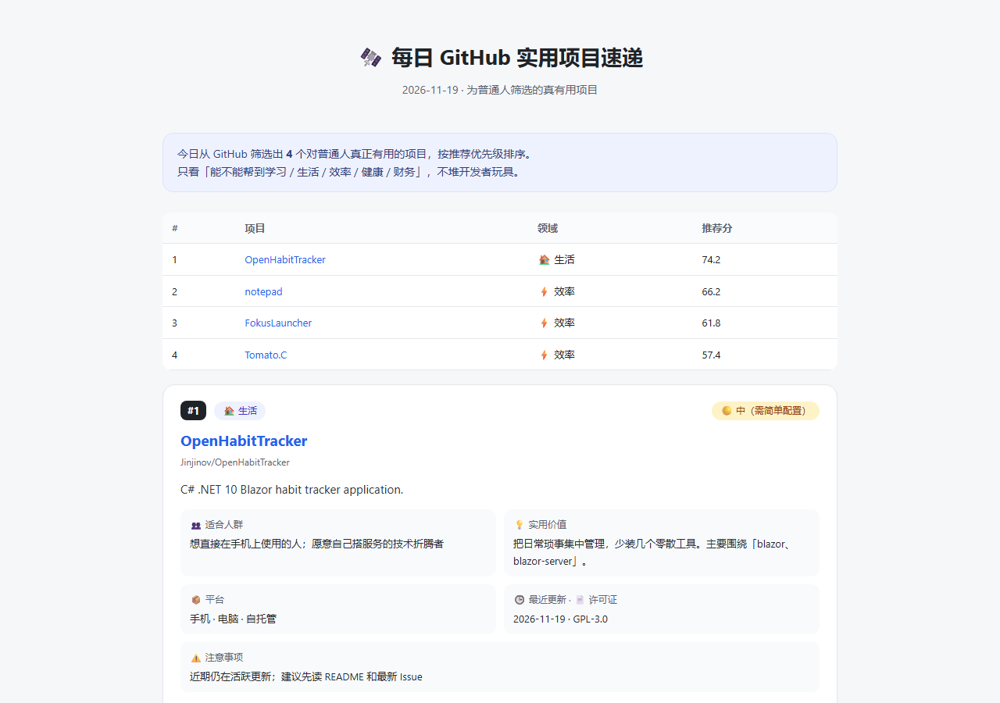

# 少数派发布终稿（可直接复制）

> 发布前只需做一件事：把文中图片链接换成你上传到少数派后的图片地址（如果外链图能正常显示，可不换）。其余内容可直接粘贴。已经过一次去 AI 腔处理。

**标题（选一个）**

- 主推：**GitHub 上每天冒出几百个新项目，我写了个工具，只挑普通人能用上的**
- 备选 1：**给不写代码的人做了一份 GitHub 日报，每天几个，30 天不重样**
- 备选 2：**我用 Python 做了个「只推荐普通人能用」的 GitHub 日报**

**摘要（发布页填）**

一个零依赖的小工具。每天从 GitHub 里挑几个普通人真能用上的项目，生成一份中文日报，顺手还能发到网页上。

---

以下为正文，从标题下方开始复制：

---

## 起因：朋友要推荐，我却打开了一屏看不懂的东西

前几天有个朋友问我，GitHub 上是不是有很多好用的小工具，让我给他推荐几个。

我打开 Trending，看了几秒就有点尴尬。满屏都是框架、SDK、命令行工具、数据库。这些项目作者写得很兴奋，但我那朋友只会用微信和浏览器，他想知道的是「今天有什么我能装的」，不是「这个技术有多新」。

后来我发现这不能怪 Trending。HelloGitHub、GitHubDaily，还有这两年冒出来的各种 AI 日报，默认都是写给开发者的。它们解决的是「值不值得学」，我朋友要的是「值不值得用」。两件事对不上。

那干脆自己做一个。只看五个领域：学习、生活、效率、健康、财务。框架、数据库、SDK 这类东西，从一开始就不放进候选池。

## 做出来的东西长这样

先看一眼成品。



这是今天跑出来的，4 个项目：习惯追踪、笔记、桌面启动器、番茄钟。我给每个都写了几行说明，具体干什么、适合谁、能帮你省什么事、支持什么平台、什么时候更新的、什么许可证。最后还加了一栏「注意事项」。

这一栏是我自己最看重的。一个项目再火，如果它得让你自己搭服务器，或者上一次更新停在三年前，你不写清楚，推荐出去就是坑人。

## 筛选这件事，我是怎么做的

踩了不少坑，现在的流程大概是这样。

先按关键词搜，一部分是最近新建的项目，一部分是最近有更新的老项目。搜回来一堆，再往下筛：没描述的、教程合集、SDK、library、framework、体积特别小的，直接丢掉。

有一类误匹配特别烦。比如搜 habit tracker，早期经常搜出一个叫 habitat 的东西，名字像，意思八竿子打不着。后来加了一层校验：搜索词里的实词必须真的出现在结果里，才算数。这下清净多了。

去重也是被逼出来的。推荐过的项目 30 天内不再出现，看过但没选上的冷却 7 天。之前没这条的时候，一份日报连着一周推同一个项目，我自己看着都烦。

还有领域配额，每个领域最多 3 个，不然「生活」类能把整页占满。

最后打分排序。带「浏览器插件」「网页版」「App」这类词的加分，带「自托管」「命令行」「Kubernetes」的扣分，没许可证的也扣分。说白了就一句话：一个 200 星、下载就能用的小工具，排在 20 万星的数据库前面。

## 怎么用

最省事的是直接看网页：https://daily-atk.github.io/github-daily-monitor/

每天北京时间 20:00 更新，也有历史归档页。什么都不用装，看到合适的转给朋友就行。

想在本地自己跑，Windows 用户双击 `运行日报.bat`，跑完会自动打开报告。第一次用先装 Python，装的时候记得勾上「Add python.exe to PATH」。macOS 和 Linux 用户执行 `chmod +x run.sh && ./run.sh`。纯 Python 标准库，不用 pip install 任何东西。

想改成自己的日报，把仓库 Fork 一份，开启 Actions，它每天会定时生成报告并发到你自己的 GitHub Pages。关键词、排除词、每领域的项目数、推送时间都在 `config.json` 里。比如你只关心健康和财务，把其他领域的关键词删掉就行。

## 关于 AI，顺便说两句

不接 AI 也能跑，报告是完整的，只是文案走的是规则兜底，比较干。上面截图里那句「主要围绕『blazor、blazor-server』」，就是没开 AI 的样子。能看，但确实生硬。

想要更具体的描述，可以接任意 OpenAI 兼容接口，DeepSeek、通义、本地模型都行：

```bash
export LLM_API_KEY="..."
export LLM_MODEL="deepseek-chat"
python enrich.py --dry-run          # 先看提示词和预估费用
python enrich.py --enable --max-cost 0.05
```

默认关闭。不加 `--enable` 不会调接口，也不花钱。`--dry-run` 可以先看看它准备发什么、大概花多少钱。

我的建议是先别开。拿兜底文案跑几天，确认筛出来的东西你真用得上，再考虑接 AI。不然花了钱，优化的只是句子通不通顺。

## 几个要先说清楚的地方

筛选靠的是规则，不是人工把关，质量会有起伏。

「对普通人有价值」这件事本身就挺主观。看到不该推的，去 Issue 里骂我一句，我改。

也不保证每天凑满 10 个。宁缺毋滥，像今天就只有 4 个。

它只聚合公开信息，不会替你安装任何东西。真要用，还是自己看一眼许可证和 Issue。

还有，项目名字里带 GitHub，但跟 GitHub 官方没关系。

## 最后

代码和完整说明在 https://github.com/daily-atk/github-daily-monitor

觉得有用就把网页链接转给朋友。我写这东西，本来就是给不写代码的人看的。
